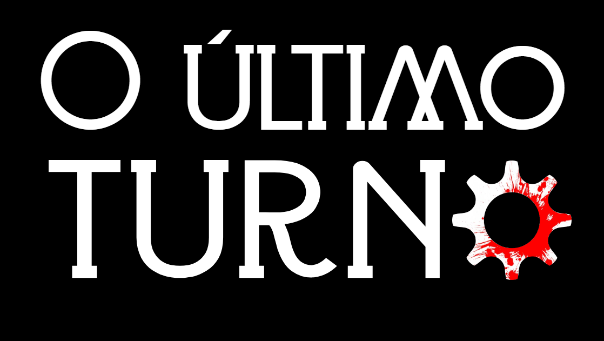

# O Último Turno

Jogo de investigação (*whodunit*) em linguagem C, feito para a atividade prática da disciplina de Algoritmos e Estrutura de Dados (AED 2026.2, CESAR School).

## Sobre o jogo

Um operário de *Tempos Modernos*, Chaplin, é encontrado morto ao fim do turno na sala de máquinas da fábrica. O jogador conduz a investigação como **Miss Marple** ou **Hercule Poirot** e tem **4 dias** para descobrir o culpado entre os suspeitos.

O assassino está entre os suspeitos e age nas noites seguintes à primeira, que passa sem mortes. Todo dia há um debate: o jogador interroga, os outros suspeitos reagem e ele decide se prende alguém. Prender um inocente custa credibilidade. Chegar ao dia 4 sem prender o culpado é game over.

## Objetivo

Descobrir quem matou Chaplin, usando o caderno de pistas e depoimentos, antes que os 4 dias acabem ou que a credibilidade chegue a zero.

## Como funciona (resumo)

- **Duração:** 4 dias.
- **Suspeitos:** 6 no início (Gerente, Capataz, Engenheiro, Operário, Enfermeira e Vigia noturno), com 1 assassino e, possivelmente, 1 cúmplice.
- **Cada dia tem 4 fases:** Manhã (resumo e pista), Debate, Julgamento e Noite. A primeira noite passa sem mortes.
- **Debate:** os turnos seguem uma volta completa na lista de suspeitos vivos. O jogador pergunta, o suspeito responde e os demais reagem com "Concordo" ou "Discordo".
- **Credibilidade:** começa em **75**. Prender um inocente custa **25** pontos; prender o cúmplice custa **15**. Chegar a 0 é game over.
- **Cúmplice:** se existir, prendê-lo não vence: custa 15 de credibilidade e revela uma pista verdadeira sobre o assassino.
- **Pontuação:** cada dia ainda não usado vale 200 pontos, cada ponto de credibilidade restante vale 10 e cada contradição encontrada no caderno vale 50; fechar o caso em vitória soma 3000. O total aparece no cabeçalho da partida e na tela final, junto com o texto do desfecho.
- **Caderno:** registra depoimentos, pistas e reações, destaca contradições e permite ordenar evidências.

## Estruturas de dados e algoritmos

| Item | Onde é usado |
|---|---|
| Lista circular duplamente encadeada | Ordem dos turnos dos suspeitos no debate |
| Lista duplamente encadeada | Seções e registros do caderno |
| Lista simplesmente encadeada | Resultados filtrados do caderno |
| Matriz de agenda `[dia][período][suspeito]` | Locais de cada suspeito e local do crime |
| Gerador xorshift32 | Papéis, agenda e vítimas reproduzíveis a partir de uma semente |
| Bubble sort | Ordenação das evidências |

## Tecnologias

- Linguagem **C11**.
- **raylib 6.2** (submodule) para a interface gráfica; canvas virtual de 1280×720, redimensionável e com tela cheia (F11).
- Interface de terminal completa como alternativa sem dependências gráficas.
- Build com **Makefile** (Linux) e **CMake 3.22+** (Windows, Linux e macOS).

## Jogar sem compilar (release)

Se você só quer jogar, baixe um pacote pronto na aba [**Releases**](https://github.com/RiosGabri/Ultimo-turno/releases) do GitHub: abra a release mais recente e expanda **Assets** para ver os arquivos. Não é preciso instalar compilador, CMake, Git nem a raylib: o pacote já contém o executável e, na versão gráfica, a pasta `assets/`. Use sempre a release mais recente (no momento desta atualização, `v0.2.0-alpha.63`); as publicações atuais são pré-releases.

| Sistema | Interface gráfica | Terminal |
|---|---|---|
| Windows | `ultimo-turno-grafico-windows-<versão>.zip` | `ultimo-turno-windows-<versão>.zip` |
| Linux | `ultimo-turno-grafico-linux-<versão>.tar.gz` | `ultimo-turno-linux-<versão>.tar.gz` |
| macOS | `ultimo-turno-grafico-macos-<versão>.tar.gz` | `ultimo-turno-macos-<versão>.tar.gz` |

**Windows:** extraia o `.zip` com o botão direito do mouse em *Extrair Tudo* (ou use o PowerShell) e execute `jogo.exe` com duplo clique; no pacote do terminal, execute `jogo-terminal.exe`.

```powershell
Expand-Archive .\ultimo-turno-grafico-windows-v0.2.0-alpha.63.zip -DestinationPath .\ultimo-turno
cd .\ultimo-turno
.\jogo.exe
# No pacote somente do terminal: .\jogo-terminal.exe
```

**Linux e macOS:** extraia o `.tar.gz` dentro de uma pasta nova e execute o binário. Se o sistema não preservou a permissão de execução, rode `chmod +x` antes.

```sh
mkdir ultimo-turno
tar -xzf ultimo-turno-grafico-linux-v0.2.0-alpha.63.tar.gz -C ultimo-turno
cd ultimo-turno
chmod +x jogo          # somente se necessário
./jogo
# No pacote somente do terminal: ./jogo-terminal
```

No macOS, se o sistema bloquear a abertura por ser um binário não assinado, use *Ajustes do Sistema → Privacidade e Segurança → Abrir mesmo assim* (ou `xattr -d com.apple.quarantine ./jogo`). No Linux, a versão gráfica ainda precisa das bibliotecas gráficas/X11 do sistema em tempo de execução, normalmente já presentes em um desktop; `jogo-terminal` não tem essa exigência.

## Compilando a partir do código-fonte

O projeto tem dois executáveis:

- `jogo` — interface gráfica (raylib): menu, história, escolha do detetive, manhã, debate, caderno, julgamento, noite e tela final.
- `jogo-terminal` — partida completa no terminal, sem raylib.

O código da raylib está no submodule `raylib/`, fixado na tag **6.2**. Clone já com os submódulos:

```sh
git clone --recurse-submodules https://github.com/RiosGabri/Ultimo-turno.git
```

Se o repositório já foi clonado sem eles:

```sh
git submodule update --init --recursive
```

> A pasta `assets/` (fontes, imagens e logotipo) deve acompanhar o executável gráfico. O CMake já a copia para junto do binário; com o Makefile, execute o jogo a partir da raiz do repositório.

### Windows

Use o CMake; o Makefile não é suportado no Windows.

1. Instale o **CMake 3.22+**, o **Git for Windows** e o **Visual Studio 2022** com a carga de trabalho *Desenvolvimento para desktop com C++*.
2. No **PowerShell** (ou no Git Bash), clone o repositório com os submódulos e entre na pasta:

   ```powershell
   git clone --recurse-submodules https://github.com/RiosGabri/Ultimo-turno.git
   cd Ultimo-turno
   ```

3. Configure e compile em Release:

   ```powershell
   cmake -S . -B build-cmake
   cmake --build build-cmake --config Release
   ```

4. Execute:

   ```powershell
   .\build-cmake\Release\jogo.exe          # interface gráfica
   .\build-cmake\Release\jogo-terminal.exe # interface de terminal
   ```

Para gerar **apenas o terminal** (sem baixar/compilar a raylib):

```powershell
cmake -S . -B build-cmake -DULTIMO_TURNO_BUILD_JOGO=OFF
cmake --build build-cmake --config Release
.\build-cmake\Release\jogo-terminal.exe
```

Testes:

```powershell
ctest --test-dir build-cmake -C Release --output-on-failure
```

O terminal ajusta automaticamente a página de código do console para UTF-8, para os acentos aparecerem corretamente.

### Linux

Dependências no Debian/Ubuntu/Linux Mint (as bibliotecas X11/OpenGL são necessárias apenas para a raylib):

```sh
sudo apt install build-essential git cmake libx11-dev libxrandr-dev libxinerama-dev libxcursor-dev libxi-dev libgl1-mesa-dev
```

Clone com os submódulos e entre na pasta:

```sh
git clone --recurse-submodules https://github.com/RiosGabri/Ultimo-turno.git
cd Ultimo-turno
```

**Com Makefile** (a partir da raiz do repositório):

```sh
make                 # compila a raylib e o jogo gráfico
./build/jogo

make terminal        # compila somente o terminal
./build/jogo-terminal

make run             # compila e roda o jogo-terminal
```

**Com CMake** (alternativa para os dois executáveis):

```sh
cmake -S . -B build-cmake
cmake --build build-cmake
./build-cmake/jogo
./build-cmake/jogo-terminal
```

Em Fedora/RHEL, substitua a instalação por `sudo dnf install gcc git cmake libX11-devel libXrandr-devel libXinerama-devel libXcursor-devel libXi-devel mesa-libGL-devel`.

### macOS

O Makefile usa `-lGL`/`-lX11` e não se aplica ao macOS; use o CMake (a raylib é linkada contra os frameworks do sistema).

1. Instale as ferramentas de compilação e o CMake:

   ```sh
   xcode-select --install
   brew install cmake   # se ainda não tiver o CMake
   ```

2. Clone com os submódulos e compile:

   ```sh
   git clone --recurse-submodules https://github.com/RiosGabri/Ultimo-turno.git
   cd Ultimo-turno
   cmake -S . -B build-cmake
   cmake --build build-cmake
   ```

3. Execute:

   ```sh
   ./build-cmake/jogo
   ./build-cmake/jogo-terminal
   ```

Para usar o gerador do Xcode:

```sh
cmake -S . -B build-cmake -G Xcode
cmake --build build-cmake --config Release
./build-cmake/Release/jogo
./build-cmake/Release/jogo-terminal
```

Em qualquer sistema, para gerar só o terminal e os testes sem a raylib:

```sh
cmake -S . -B build-cmake -DULTIMO_TURNO_BUILD_JOGO=OFF
cmake --build build-cmake
```

### Testes e limpeza

Com o Makefile (Linux):

```sh
make test        # testes das estruturas, do dia e do jogo
make test-ui     # fonte .ttf com acentos e auxiliares de interface (raylib)
make valgrind    # testes com verificação de memória
make clean       # remove a pasta build/
make distclean   # remove build/ e os artefatos compilados da raylib
```

Com o CMake (todos os sistemas):

```sh
ctest --test-dir build-cmake --output-on-failure
# no Windows com Visual Studio:
ctest --test-dir build-cmake -C Release --output-on-failure
```

## Como jogar

### Interface gráfica

O fluxo completo roda na janela do jogo: **menu** → **prólogo** → escolha do **detetive** → **manhã** → **debate** → **julgamento** → **noite** (interlúdio) → próximo dia ou **fim do caso**.

- **Manhã:** mostra a pista do dia; abre o caderno ou segue para o debate.
- **Debate:** escolha o suspeito e o período a interrogar; veja o depoimento, as reações e o alerta de novas contradições. `C` abre o caderno e `E` encerra o debate.
- **Caderno:** depoimentos, pistas, reações e contradições; volta à tela anterior ao sair.
- **Julgamento:** escolha um suspeito, confirme a prisão (ou opte por não prender ninguém) e veja o resultado.
- **Noite:** primeira noite sem mortes; nas seguintes, o assassino pode atacar um inocente.
- **Fim:** texto do desfecho, identidade de assassino e cúmplice, pontuação e opção de jogar de novo ou sair.

Navegue com **mouse** (hover e clique) ou **teclado** (setas/Tab para mudar o foco, Enter/Espaço para confirmar, Esc para voltar). Use **F11** para alternar tela cheia.

### Terminal

A partida completa também roda no terminal: escolha o detetive pelo número, acompanhe as quatro fases de cada dia e use o caderno para cruzar depoimentos, pistas, reações e contradições.

```sh
make run                        # Linux (compila e executa)
./build/jogo-terminal           # Linux, após make terminal
.\build-cmake\Release\jogo-terminal.exe  # Windows (CMake)
./build-cmake/jogo-terminal     # macOS/Linux (CMake)
```

A versão de terminal não depende da raylib.

## Estrutura do projeto

```text
.
├── assets/                  # logotipo, imagens e fontes (.ttf)
├── docs/
│   ├── referencia/          # design system e referências visuais das telas
│   └── RELATORIO-PARTIDAS.md
├── estruturas/
│   ├── entidades/           # caderno, suspeitos, personagens, locais, texto, aleatório
│   └── listas/              # lista simples, dupla e dupla circular
├── interface/
│   ├── telas/               # caderno, debate e julgamento
│   ├── recursos.c           # carregamento de texturas
│   ├── telas.c              # menu, história, seleção, manhã e interlúdio
│   └── ui.c                 # fontes, canvas, texto e botões
├── terminal/                # interface de terminal
├── test/                    # testes unitários
├── main.c / jogo.c / dia.c  # ponto de entrada gráfico, motor do jogo e fases
├── jogo_terminal.c          # interface de terminal
├── Makefile / CMakeLists.txt
```

Relatórios adicionais: `docs/RELATORIO-PARTIDAS.md` (partidas de teste) e `docs/referencia/DESIGN.md` (paleta, tipografia e componentes).

## Equipe

<table>
  <tbody>
    <tr>
      <td align="center" valign="top" width="14.28%"><a href="https://github.com/Torzinus"><br /><sub><b>Heitor de Carvalho</b></sub></a><br /><a href="https://github.com/RiosGabri/Ultimo-turno/commits?author=Torzinus" title="Code"></a></td>
      <td align="center" valign="top" width="14.28%"><a href="https://github.com/LarissaGiovanna"><br /><sub><b>Larissa Giovanna</b></sub></a><br /><a href="https://github.com/RiosGabri/Ultimo-turno/commits?author=LarissaGiovanna" title="Code"></a></td>
      <td align="center" valign="top" width="14.28%"><a href="https://github.com/RiosGabri"><br /><sub><b>Gabriel Parméra</b></sub></a><br /><a href="https://github.com/RiosGabri/Ultimo-turno/commits?author=RiosGabri" title="Code"></a></td>
      <td align="center" valign="top" width="14.28%"><a href="https://github.com/eduardommb"><br /><sub><b>Eduardo Braga</b></sub></a><br /><a href="https://github.com/RiosGabri/Ultimo-turno/commits?author=eduardommb" title="Code"></a></td>
        <td align="center" valign="top" width="14.28%"><a href="https://github.com/eliancunha"><br /><sub><b>Elian Cunha</b></sub></a><br /><a href="https://github.com/RiosGabri/Ultimo-turno/commits?author=eliancunha" title="Code"></a></td>
    </tr>
  </tbody>
</table>

## Referências

- *Death Note: Kira Game*
- *Tempos Modernos* (Charles Chaplin)
- *Enola Holmes*
- Obras literárias de Agatha Christie
- Investigação póstuma
